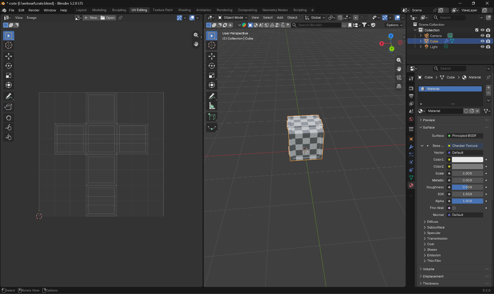
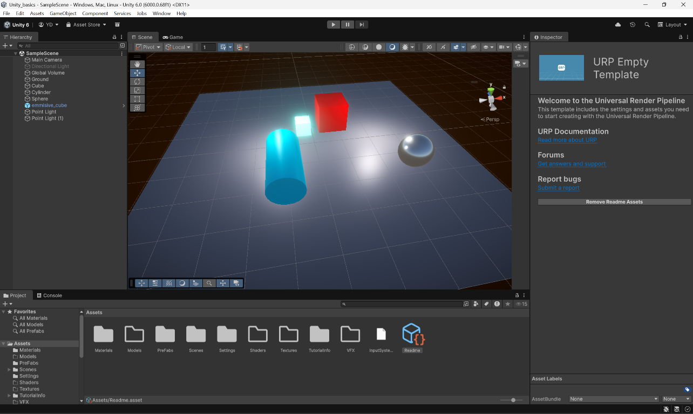

# Unity URP Technical Art Practice

A Unity 6 URP project for practicing PBR materials, lighting, skyboxes, and post-processing.
It contains a lit sample scene and a reusable emissive cube prefab.

## Requirements

- Unity 6 LTS (project version `6000.0.68f1`)
- Universal Render Pipeline (URP package `17.0.4`)

## How to Open the Project

1. Clone the repository.
2. In Unity Hub, choose **Add project from disk**.
3. Select the cloned project folder and open it.

## What's in the Scene

- `SampleScene` contains a camera, Cube, Cylinder, Sphere, Ground, and Global Volume.
- `Assets/crate.fbx` is a low-poly crate model with UVs.
- The scene uses the `m_sky` procedural skybox material.
- Material values:

| Material | Metallic | Smoothness |
|---|---:|---:|
| `M_Cube` | 0 | 0.5 |
| `M_Cylinder` | 0 | 0.5 |
| `M_Ground` | 0.179 | 0.5 |
| `M_Sphere` | 1 | 0.803 |
| `M_Emissive` | 0 | 0.5 |

- The Directional Light is present but inactive.
- `Point Light` and `Point Light (1)` are enabled; both have white color, intensity 3, and range 6.
- The `emmisive_cube` prefab uses the emissive material.

## Crate Model

The crate was modeled and UV-unwrapped in Blender. Normal and ambient occlusion maps were baked from the high-poly mesh onto the low-poly mesh. The re-exported [`Assets/crate.fbx`](Assets/crate.fbx) contains only the low-poly crate mesh.
The [Blender source](Assets/crate.blend) retains the high- and low-poly meshes for future edits or rebaking.

The [`M_CRATE` material](Assets/Materials/M_CRATE.mat) uses the baked maps:

- [`Crate_Normal.png`](Assets/Textures/Crate_Normal.png) — tangent-space normal map.
- [`Crate_AO.png`](Assets/Textures/Crate_AO.png) — ambient occlusion map, imported as linear data.

## Post-processing

The scene's Global Volume uses `Assets/Settings/Global Volume Profile.asset`:

- **Bloom:** threshold 0.9, intensity 1, scatter 0.7.
- **Color Adjustments:** post exposure 0, contrast 10, saturation 10.
- **Vignette:** intensity 0.3, smoothness 0.4.

## Folder Structure

- `Assets/Scenes/` — sample scene and scene template.
- `Assets/Materials/` — PBR, emissive, and skybox materials.
- `Assets/PreFabs/` — the emissive cube prefab.
- `Assets/Models/` — reserved for 3D models; the low-poly crate FBX is at `Assets/crate.fbx`.
- `Assets/Textures/` — baked crate normal and ambient occlusion maps.
- `Assets/Shaders/` — no non-generated asset files currently.
- `Assets/VFX/` — no non-generated asset files currently.
- `Assets/Settings/` — render pipeline assets and Volume Profiles.

## What I Learned

- I learned that Built-in pipeline materials turn pink in URP. I fixed them by switching their shaders to Universal Render Pipeline/Lit and setting the base color, metallic, and smoothness again.
- I learned to assign URP in Project Settings under Graphics and Quality so Volumes and post-processing work. Starting with the Universal 3D template helps.
- I learned that metallic controls a surface's metal-like response and smoothness affects reflection sharpness. Colored lights look different on rough and shiny materials.
- I learned that Bloom only affects values above its threshold, so emissive materials need HDR intensity above 1. Bloom is set in a Volume Profile, not on the camera.
- I learned that URP post-processing uses a Global Volume, a Volume Profile, and overrides. A Missing Script on a Volume can mean URP is not installed or active.
- I learned to save the scene and commit from VS Code, and to add a Unity `.gitignore` before committing so `Library`, `Temp`, and `Logs` stay out of Git.
- I learned that setting `core.autocrlf` to `false` can prevent LF/CRLF warnings on Windows.

## Final Output

